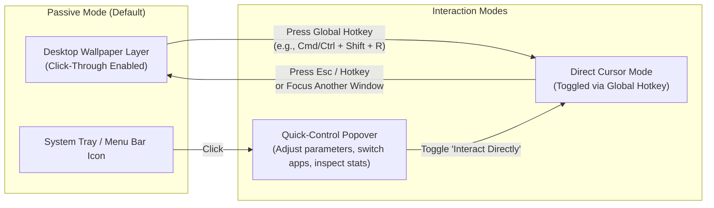
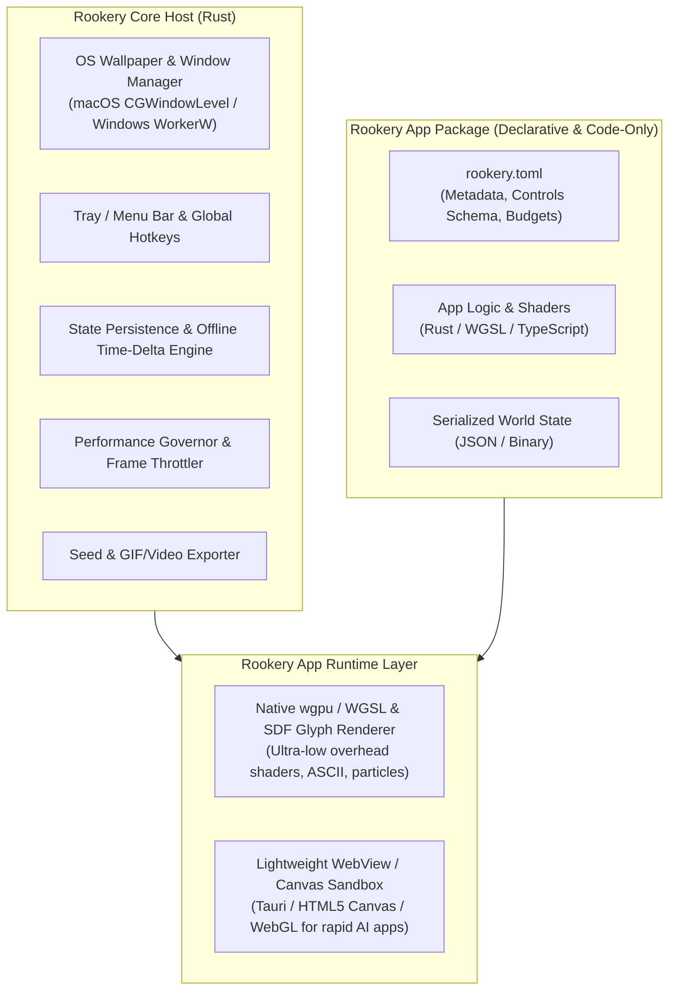
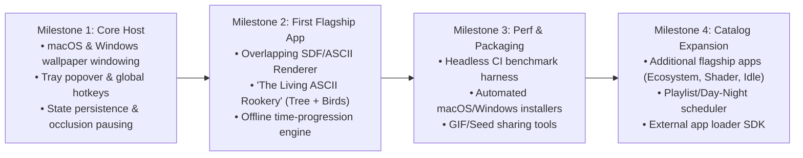

# Rookery: Project Vision & Architecture

> **Living Worlds & Ambient Simulations for Your Desktop**  
> *Open-Source (MIT) • Cross-Platform (macOS & Windows) • AI-Native • Ultra-Lightweight*

---

## 1. Executive Summary & Core Philosophy

**Rookery** is an open-source hub and runtime engine for interactive, procedural animations and slow-burn ambient games—called **Rookery Apps**—that live quietly on your computer's desktop background.

Traditional dynamic wallpapers merely loop static video files or GIFs. They consume unnecessary resources, offer zero visual variety after the first loop, and cannot be interacted with. **Rookery** reimagines the desktop background as a living canvas: an evolving ecosystem, an algorithmic art installation, or a cozy idle simulation that progresses continuously in the background and invites brief, meaningful moments of interaction throughout the day.

### Core Pillars

| Pillar | Vision |
| :--- | :--- |
| **1. Ambient First, Interactive When Wanted** | Rookery Apps are designed to be admired passively for hours and interacted with for seconds or a couple of minutes a day. Never demanding, always rewarding. |
| **2. Featherweight Performance** | A background app must never slow down foreground work. Rookery enforces strict CPU, GPU, memory, and battery budgets backed by automated headless CI benchmarks. |
| **3. 100% AI-Native & Code-First** | Every part of the Rookery engine and its apps is architected to be authored, tested, and maintained by AI coding agents. Zero reliance on proprietary GUI editors, binary scene files, or manual IDE workflows. |
| **4. Effortless Accessibility** | Built for everyone—not just developers. Installing Rookery or switching Rookery Apps should take a minimal series of clicks via native installers and a clean system tray / menu bar interface. |
| **5. Organic Spreadability** | Designed to make onlookers ask, *"What is running on your desktop?"* Includes built-in tools for capturing clean loops, sharing world seeds, and exporting snapshots. |
| **6. Fully Open Source (MIT)** | Every component, dependency, and asset pipeline adheres strictly to the MIT License. |

---

## 2. User Experience & Interaction Model

Interacting with a desktop wallpaper poses unique UX challenges: OS desktop icons, window focus, and accidental clicks. Rookery solves this through a **Dual-Mode Interaction Architecture**:

### 2.1 System Tray / Menu Bar Hub (Primary Control)
A lightweight icon lives in the macOS Menu Bar and Windows System Tray. Clicking it opens the **Rookery Popover**, allowing users to:
- **Browse & Switch Apps**: Instantly swap between installed Rookery Apps or configure a **Playlist / Schedule** (e.g., rotate daily or transition from day to night apps).
- **App-Specific Quick Controls**: Perform daily check-ins or micro-adjustments (e.g., pruning a branch, setting resource priorities in a tiny village, feeding koi, or tweaking simulation sliders) right from the popover UI without leaving their current workspace.
- **Share & Capture**: One-click export of a high-FPS GIF/MP4 clip, clean screenshot, or shareable **World Seed / State File**.

### 2.2 Direct Desktop Interaction Mode (Hotkey-Toggled)
When a user wants to directly touch, pan, or play inside the desktop world:
- Pressing a customizable **Global Hotkey** (or clicking *"Interact on Desktop"* in the tray popover) temporarily promotes the Rookery surface to capture mouse and keyboard events.
- A subtle visual indicator (e.g., a soft vignette or corner badge) confirms that **Direct Interaction Mode** is active.
- Clicking into any normal application window or pressing `Esc` immediately returns Rookery to passive, click-through wallpaper mode.

### 2.3 Audio Policy
- **Strictly Silent by Default**: Rookery Apps never play unsolicited audio in the background.
- **Opt-In Ambient Sound / SFX**: Users can explicitly toggle ambient soundscapes or subtle interaction SFX via the tray popover, or enable audio exclusively while in Direct Interaction Mode.

---

## 3. Flagship "Rookery Apps" & Archetypes

Individual experiences running inside Rookery are called **Rookery Apps**. While the platform supports both purely procedural visuals and curated custom art assets, every app emphasizes timeless aesthetics and continuous evolution.

### 3.1 The Signature Launch App: *The Living ASCII Rookery*
> **Concept**: An algorithmic, layered ASCII tree that grows imperceptibly slowly over days and weeks, inhabited by procedural birds that fly across the screen and perch in its branches.

- **Overlapping Character Rendering**: Unlike standard rigid terminal grids, characters are rendered as independent vector/signed-distance-field (SDF) glyphs in 2D space. Letters and symbols can overlap with subtle depth, opacity, and wind sway—creating rich, textured bark and foliage while keeping every individual character crisp and legible.
- **Real-Time & Offline Growth**: The tree grows slowly enough that you can watch new shoots form if you stare closely, while evolving significantly over days.
- **Autonomous Wildlife**: Little birds (forming a literal *rookery*) periodically glide in from the edges of the screen, react to branch geometry, build nests, perch, and take flight when interacted with.
- **Micro-Interactions**: Users can drop seeds, gently prune branches to guide the tree's silhouette, or leave snacks on branches to attract rare bird species.

### 3.2 Core App Archetypes

| Archetype | Description & Examples | Interaction Cadence |
| :--- | :--- | :--- |
| **1. Cozy Living Ecosystems & Terrariums** | Self-sustaining worlds that grow over days and weeks: *The Living ASCII Rookery*, a tranquil koi pond with lily pads, a cross-section ant colony, a bonsai garden, or a miniature pixel village. | 1–3x daily (feed, prune, plant, guide growth) |
| **2. Generative Art & Physics Simulations** | Mesmerizing algorithmic visuals: boids flocking through shifting wind fields, falling-sand cellular automata, reaction-diffusion coral, and procedural WGSL shader landscapes. | On-demand (tweak parameters, stir fluid, drop elements) |
| **3. Slow-Burn Idle & Incremental Worlds** | Low-cognitive-load strategy worlds: an orbital space station slowly assembling modules, an expanding miniature train network, or autonomous resource gatherers. | 1–2x daily (set build queues, adjust resource sliders) |
| **4. Ambient Utility & Reactive Scenes** | Worlds synchronized with reality: a cozy cabin or skyline that shifts with real local time-of-day and weather, or a subtle visual companion that blooms during focus sessions. | Passive / automatic |

---

## 4. Technical Architecture & AI-Native Design

To balance **ultra-low background resource usage** with **rapid, 100% AI-generated app creation**, Rookery uses a **Hybrid Rust + Lightweight Canvas/Shader Architecture**.

### 4.1 Why This Stack?
1. **Rust Core Host**:
   - Handles low-level OS wallpaper window attachment on **macOS** (attaching below desktop icons via `NSWindow` / `CGWindowLevelForKey(kCGDesktopWindowLevelKey)`) and **Windows** (attaching to the desktop `Progman` / `WorkerW` hierarchy).
   - Manages global hotkeys, system tray popovers, state serialization, and hardware monitoring with virtually zero memory overhead.
2. **Dual Rendering Backends**:
   - **Native `wgpu` / WGSL / SDF Pipeline**: Ideal for ultra-lightweight procedural simulations, shader art, and crisp overlapping glyph rendering (such as *The Living ASCII Rookery*).
   - **Lightweight WebView / Canvas Layer (via Tauri)**: Allows AI agents to rapidly generate rich 2D/3D visual apps using standard TypeScript, HTML5 Canvas, or WebGL when rapid iteration is prioritized.
3. **100% AI-Native Workflow (Zero GUI Requirement)**:
   - **No Proprietary Editors**: Unlike Unity, Unreal, or Godot scene workflows that require clicking around an IDE, every Rookery App is defined strictly by human- and LLM-readable source files (`rookery.toml`, code, and shaders).
   - **Declarative Tray UI**: Apps declare their tray control sliders, buttons, and stats in `rookery.toml` or via a simple JSON schema. The Rookery Host automatically renders the control panel—agents never have to manually wire up boilerplate settings menus.
   - **Procedural & Code-First Assets**: Visuals prioritize SDF shapes, overlapping typography, shaders, SVG/vector paths, and procedural palettes that AI agents can write and refine directly in code. Dedicated sprite/art assets are supported via clean folder conventions when desired.

### 4.2 Persistent State & Offline Time-Progression
Because users put their computers to sleep or switch apps, Rookery treats **time** as a first-class primitive:
- Every Rookery App implements a standard lifecycle hook: `on_wake(elapsed_seconds: f64, state: &mut AppState)`.
- When the computer wakes from sleep or a user reloads an app after 12 hours, the host passes the exact elapsed wall-clock delta so the app can deterministically fast-forward simulation ticks (e.g., growing the ASCII tree, advancing resource gathering, or shifting the sun position) and periodically snapshots state to disk.

### 4.3 Ecosystem & App Packaging
- **Phase 1 (Curated First-Party Catalog)**: Ships with a cohesive suite of flagship Rookery Apps bundled right out of the box.
- **Phase 2 (Open Folder / GitHub Loading)**: Because every Rookery App follows a strict directory contract (`rookery.toml` + entry point), users and developers can load custom apps from a local folder or paste a GitHub repository URL to install community creations.

---

## 5. Performance Budget & Automated Testing Framework

A background application lives or dies by its resource footprint. Rookery treats performance regressions the same way it treats compilation errors.

### 5.1 Target Resource Budgets
| Metric | Active Wallpaper Target | Occluded / Fullscreen App Active | On Low Battery / Power Saver |
| :--- | :--- | :--- | :--- |
| **CPU Usage** | `< 1.5%` average | `0.0%` (Simulation paused) | `< 0.5%` (Throttled tick rate) |
| **Memory (RAM)** | `< 120 MB` RSS | `< 120 MB` RSS | `< 120 MB` RSS |
| **Frame Rate** | Adaptive `15–30 FPS` (60 FPS in Direct Interactive Mode) | `0 FPS` (Render loop suspended) | `10–15 FPS` |

### 5.2 Smart Runtime Governor
The Rust host continuously monitors OS state to avoid wasting cycles:
- **Occlusion Detection**: When a maximized or fullscreen window covers the desktop on a monitor, rendering on that display automatically drops to `0 FPS`.
- **Adaptive Frame Pacing**: Ambient animations like a slowly growing tree only need `15–24 FPS` during passive viewing, seamlessly ramping up to `60 FPS` the moment a bird flies across the screen or the user activates Direct Interaction Mode.

### 5.3 Headless Performance CI Pipeline
To allow AI agents to autonomously build and optimize Rookery Apps without manual profiling:
1. **Deterministic Headless Runner (`rookery-bench`)**: Runs any Rookery App for $N$ simulated frames in a headless offscreen buffer using a fixed random seed.
2. **Automated Telemetry Assertions**: Measures per-frame CPU tick time, GPU command buffer submission time, memory allocations, and peak RSS.
3. **Visual Regression Snapshots**: Captures frame output at tick `0`, `1,000`, and `10,000` so both humans and vision-capable AI agents can inspect visual quality and verify that procedural shaders render as intended.

---

## 6. Distribution, Accessibility & Spreadability

### 6.1 Frictionless Installation for Non-Technical Users
- **Automated GitHub Releases**: Every tagged release builds native installers via GitHub Actions for **macOS** (Universal `.dmg` + Homebrew Cask) and **Windows** (`.msi` / `.exe` setup + Winget).
- **Zero-Terminal Onboarding**: Double-click installer, launch Rookery, and it immediately appears in the Menu Bar / System Tray with the default Rookery App running on the desktop.
- **Built-In Auto-Updater**: Silent or one-click updates directly from the tray menu.
- **Platform Prioritization**: Tier-1 support for **macOS** and **Windows**. Linux (Wayland/X11) architecture will be kept modular in the OS abstraction layer for future community expansion without slowing initial velocity.

### 6.2 Built-In Viral & Sharing Features
Since dynamic wallpapers naturally spark curiosity in offices, coffee shops, and streams, Rookery makes sharing effortless:
- **Instant Loop Recorder**: Capture a clean, icon-free 5-second GIF or MP4 of your desktop simulation directly from the tray menu to post on social media, Reddit, or Discord.
- **Shareable World Seeds & State Strings**: Copy a compact seed string (e.g., `rookery://tree/seed-8492a...`) so friends can grow the exact same tree variant or load a snapshot of your thriving ecosystem.

---

## 7. Phased Roadmap

1. **Milestone 1 — Core Desktop Host & UX Foundation**:
   - Build the cross-platform Rust host attaching to macOS and Windows desktop layers.
   - Implement the System Tray / Menu Bar popover and global hotkey toggle for Direct Interaction Mode.
   - Implement window occlusion detection and automatic FPS throttling.
2. **Milestone 2 — Flagship App (*The Living ASCII Rookery*) & Persistence**:
   - Build the overlapping character/glyph renderer and procedural growth algorithm.
   - Implement autonomous bird flocking, perching, and subtle user interactions (seeding/pruning).
   - Build the persistent save state and offline time-delta catch-up engine.
3. **Milestone 3 — Performance Harness & One-Click Distribution** [✅ COMPLETE]:
   - Build `rookery-bench` for automated headless performance and visual regression testing.
   - Configure GitHub Actions CI/CD to produce one-click macOS and Windows installers.
   - Add snapshot/GIF export and World Seed sharing.
4. **Milestone 4 — First-Party Catalog & Open App SDK** [✅ COMPLETE]:
   - Author 3 additional flagship Rookery Apps across core archetypes (*Tranquil Koi Pond*, *Cosmic Nebula*, *Orbital Haven*).
   - Implement `rookery.toml` App Manifest specification and dynamic control schema.
   - Build runtime zero-tear app switcher and Playlist / Day-Night scheduler.
   - Implement global popover toggle hotkey and horizontal forest panning.

