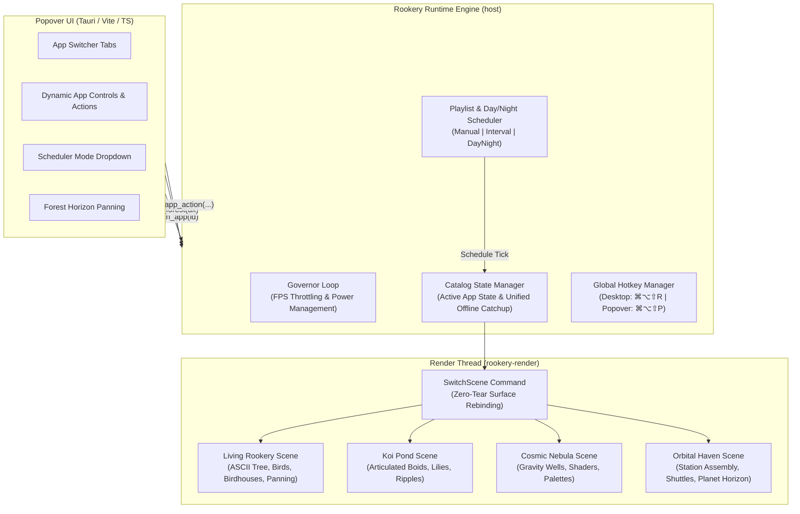

# Rookery Architecture: Catalog, Open App SDK & Scheduler

> **Milestone 4 Reference Specification**  
> *Four Flagship Apps • `rookery.toml` Manifest Specification • Dynamic App Switching & Day/Night Scheduler • Offline Catch-Up Across Apps*

---

## 1. Overview

Milestone 4 expands **Rookery** from a single flagship simulation (*The Living ASCII Rookery*) into a multi-app desktop engine and open ecosystem. Users can switch between diverse visual archetypes, rotate apps via an interval playlist or natural day/night cycle, and third-party creators can package custom apps using the open `rookery.toml` manifest specification.



---

## 2. The Four Flagship Rookery Apps

Rookery ships with four flagship apps spanning core ambient archetypes:

### 2.1 The Living ASCII Rookery (`living-rookery`)
- **Archetype**: Botanical Slow-Burn Ecosystem
- **Visuals**: Procedural branch hierarchy with overlapping ASCII glyphs (`#`, `|`, `/`, `\`), golden autumn and pink spring foliage buds, and atmospheric dusk sky.
- **Milestone 4 Enhancements**:
  - **Multi-Column Bark Reinforcement**: Thick, textured primary trunks for mature trees.
  - **Birdhouses Built Over Time**: Birds construct cozy rustic wooden birdhouses (`^ [ o ] _`) on stable branches as the tree matures.
  - **Wooden Plant Signs**: Commemorative wooden signs (`[ i ]`) marking planted sapling sites.
  - **Horizontal Forest Panning**: Smooth viewport scrolling left and right to explore expansive canopies.
  - **Ground Floor**: Moss and grass tufts (`"`, `,`, `.`, `☘`) lining the forest floor.

### 2.2 Tranquil Koi Pond (`koi-pond`)
- **Archetype**: Aquatic Zen Ecosystem
- **Visuals**: Articulated koi boids with multi-segment serpentine spines swimming through procedural caustics and water ripple waves.
- **Simulation**:
  - Lily pads and blooming lotuses (`@`, `%`, `*`) that mature over hours.
  - Smooth obstacle avoidance and natural flocking.
  - Floating food pellets (`o`) dropped by the user, leading to feeding frenzy behaviors.
  - Gentle stone ripples stirring water surface dynamics.

### 2.3 Cosmic Nebula (`cosmic-nebula`)
- **Archetype**: Generative Physics & Deep Space Shader
- **Visuals**: Multi-octave cosmic dust, ionization fronts, and glowing celestial stars.
- **Simulation**:
  - Dynamic gravitational vortex attractors (`@`, `*`) pulling particle streams into spiral arms.
  - Supernova repulsor shockwaves dispersing cosmic dust.
  - Preset astrophysical color palettes inspired by Hubble and JWST imagery (Pillars of Creation, Carina Blue, Veil Emission, Solar Flare).
  - Real-time turbulence and curl-noise controls.

### 2.4 Orbital Haven (`orbital-haven`)
- **Archetype**: Slow-Burn Sci-Fi Space Station
- **Visuals**: Planet horizon with atmospheric limb scattering, daylight terminator line, and orbiting modular space station.
- **Simulation**:
  - Modular station expansion over time (solar array wings, pressurized habitat rings, communication arrays).
  - Autonomous transport shuttles (`>`, `<`) arriving and docking with cargo pods.
  - Offline science research points accumulated while your computer is asleep.

---

## 3. The `rookery.toml` App Manifest Specification

All Rookery apps are defined by a standard, declarative `rookery.toml` manifest file located in their root folder (`apps/<app-id>/rookery.toml` or `~/.config/rookery/apps/<app-id>/rookery.toml`):

```toml
[app]
id = "aurora-waves"
name = "Aurora Waves"
description = "Interactive HTML5 canvas aurora borealis with glowing starlight and meteors."
version = "0.2.0"
author = "Rookery Community"
tags = ["web", "canvas", "aurora", "sky"]

[theme]
tagline = "Celestial Curtain"
banner_title = "Aurora Waves"
icon = "sparkle"
ornament = "✦ ─── ✧ ─── ✦"
bg = "#070c16"
card = "#0e1726"
border_outer = "#38bdf8"
accent = "#38bdf8"
accent_secondary = "#a855f7"

[budgets]
target_fps_passive = 30
target_fps_interactive = 60
max_cpu_percent = 3.0
max_memory_mb = 120

[[controls]]
type = "stat"
id = "palette"
label = "Palette"
value = "Borealis"
icon = "palette"

[[controls]]
type = "stat"
id = "meteors"
label = "Meteors"
value = "0"
icon = "shooting-star"

[[controls]]
type = "button"
id = "pulse"
label = "Solar Pulse"
icon = "sun"

[[controls]]
type = "slider"
id = "wave_speed"
label = "Wave Drift"
min = 0.2
max = 3.0
default = 1.0
```

### Supported Control Types (`[[controls]]`)
1. **`stat`**: Read-only telemetry badge rendered in the Popover HUD (`id`, `label`, `value`, optional `icon`). Can be updated live at runtime by Native scenes or Web Canvas apps via `window.Rookery.setStats({ ... })`.
2. **`button`**: Instant action trigger with an optional Phosphor/custom icon (`id`, `label`, optional `icon`). Dispatched via `execute_app_action(app_id, action_id, None)`.
3. **`slider`**: Continuous numeric parameter (`id`, `label`, `min`, `max`, `default`). Updates `CatalogState` and automatically forwards values to `u.params` in WGSL shaders or `rookery-control` events in Web Canvas apps.
4. **`select`**: Enumerated option selector (`id`, `label`, `options`, `default`).

### Supported App Runtimes
1. **Web Canvas (`index.html`)**: Served via the sandboxed `rookery-app://localhost/<app-id>/index.html` protocol. Every Web Canvas app automatically receives the `window.Rookery` SDK bridge:
   - `window.Rookery.onAction((actionId) => ...)`
   - `window.Rookery.onControl((controlId, value) => ...)`
   - `window.Rookery.onInteractive((active) => ...)`
   - `window.Rookery.onWake((elapsedSeconds) => ...)`
   - `window.Rookery.setStats({ key: value })` — streams live telemetry to the Popover HUD.
   - `await window.Rookery.saveState(data)` / `await window.Rookery.loadState()` — persists up to 512 KB of JSON state per app in `<config_dir>/apps_state/<app-id>.json`.
2. **Custom WGSL Shader (`scene.wgsl`)**: Compiled at runtime by `CustomShaderScene`. Receives `Uniforms` at `@group(0) @binding(0)` including `params: vec4<f32>` populated live from the first 4 `slider` / `select` controls in `rookery.toml`.
3. **Native Rust (`Scene` trait)**: Compiled directly into `rookery-render` for maximum simulation throughput.

---

## 4. Playlist & Day-Night Scheduler

Rookery provides three scheduling modes configured via Settings and the Popover UI:

```rust
#[derive(Debug, Clone, Copy, PartialEq, Eq, Serialize, Deserialize)]
pub enum ScheduleMode {
    /// Stay on the user's manually chosen app until changed.
    Manual,
    /// Automatically rotate through enabled apps at a fixed interval (e.g. every 15-60 mins).
    Interval,
    /// Seamlessly transition between day apps and night apps based on local wall-clock time.
    DayNight,
}
```

- **Day / Night Mapping**:
  - **Day Hours (06:00 – 18:00)**: Displays vibrant nature simulations (e.g., *Living Rookery* or *Tranquil Koi Pond*).
  - **Night Hours (18:00 – 06:00)**: Displays dark, calming celestial visuals (e.g., *Cosmic Nebula* or *Orbital Haven*).
- **Governor Integration**: The governor loop evaluates the active schedule every 5 seconds. When a transition occurs, it signals `Renderer::switch_scene` without dropping frames or tearing display surfaces.

---

## 5. Glitch-Free Scene Hot-Switching

Dynamic app switching in a multi-display desktop wallpaper presents strict rendering constraints: tearing or surface recreation produces noticeable desktop flashes.

Rookery implements zero-tear hot switching via `Renderer::switch_scene`:
1. `host` dispatches `Command::SwitchScene(SceneFactory)` to the dedicated render thread channel.
2. The render thread instantiates the new scene instances using the existing `Gpu` device context and surface formats.
3. Dimensions and display scale factors are automatically reapplied.
4. The transition takes effect on the next frame presentation with zero buffer flicker.

---

## 6. Global Menu Popover Hotkey

To accommodate users who keep their macOS menu bar hidden or prefer keyboard workflows, Rookery supports a global popover toggle hotkey:
- **Default**: `CommandOrControl+Alt+Shift+P`
- **Behavior**: Toggles the Tauri quick-control popover window from anywhere in the OS without requiring cursor travel to the menu bar icon.
- **Configurable**: Rebindable dynamically in the Settings section of the Popover UI.

