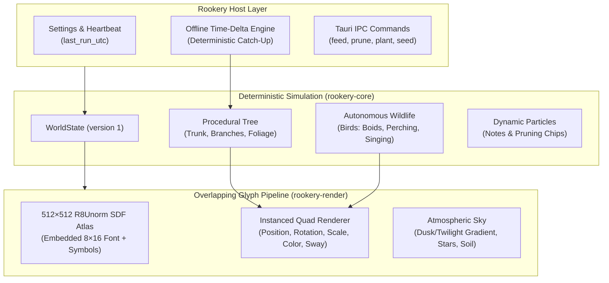

# The Living ASCII Rookery Architecture (Milestone 2)

This document describes the design, rendering pipeline, behavioral AI, and persistence model of the flagship **Living ASCII Rookery** app implemented in Milestone 2 ([`docs/VISION.md`](../VISION.md) §3.1 & §7).

---

## 1. Overview & Core Systems



---

## 2. Overlapping Character / Glyph Renderer

### 2.1 The Signed Distance Field (SDF) Atlas
Unlike rigid terminal grids with monospace cells, *The Living ASCII Rookery* renders each character as a free 2D vector-like entity in continuous pixel space:
- **Atlas Dimensions**: $512 \times 512$ single-channel (`R8Unorm`) texture generated deterministically at startup from an embedded 8×16 font.
- **Coverage**: 95 printable ASCII glyphs ($32 \dots 126$) plus custom high-fidelity symbols:
  - `♪` (index 95): single musical eighth note.
  - `♫` (index 96): beamed musical notes.
  - `☘` (index 97): sprig/clover foliage.
- **Anti-Aliasing & Sway**:
  The fragment shader uses `smoothstep` on the distance field with derivative-based width (`fwidth(dist)`), keeping glyph edges razor-sharp during branch rotation, wind oscillation, and scaling.

### 2.2 Vertex & Instance Attributes
Instances are streamed in a contiguous GPU vertex buffer (`GlyphInstance`):
```rust
#[repr(C)]
#[derive(Clone, Copy, Pod, Zeroable)]
pub struct GlyphInstance {
    pub pos: [f32; 2],        // Viewport pixel coordinates (top-left origin)
    pub size: [f32; 2],       // Width, height in pixels
    pub rotation: f32,        // Radians
    pub depth: f32,           // Z-layer
    pub uv_bounds: [f32; 4],  // [u0, v0, u1, v1] within the 512x512 atlas
    pub color: [f32; 4],      // RGBA with smooth alpha blending
    pub sway: f32,            // Wind sway amplitude multiplier
}
```

---

## 3. Procedural Tree Growth Algorithm

- **Root & Trunk**: Anchored at the horizon line ($y \approx 90\%$ of viewport).
- **Branch Propagation**:
  - Growth progress tracks from $0.0 \to 1.0$.
  - When a branch segment matures, it bifurcates into child branches at natural angular spreads ($-20^\circ \dots +30^\circ$).
  - Outer twigs (depth $\ge 2$) sprout foliage clusters with characters like `*`, `%`, `&`, `@`, `o`, `8`, `#` rendered in rich emerald, sage, and golden autumn hues.
- **Micro-Interactions**:
  - **Pruning**: Clicking or invoking `prune_branch` cuts the target branch and all its descendants, emitting fluttering falling character chips (`/`, `\`, `~`) that drift to the ground under gravity.
  - **Planting**: Invoking `plant_seed` creates a new shoot at the forest floor.

---

## 4. Autonomous Wildlife (The Rookery)

The world is populated by autonomous procedural birds:
- **Species**:
  - `Rook`: Bright silver/white crow.
  - `AzureJay`: Sapphire blue.
  - `Goldfinch`: Golden amber.
  - `Robin`: Scarlet and chestnut.
  - `EmeraldDove`: Sage and jade.
- **State Machine**:
  - `Flying`: Glides across the sky with animated wing flapping frames (`^v^`, `>o<`, `-o-`).
  - `Circling`: Glides in gentle arcs around the tree canopy.
  - `Perched`: Snaps to mature branch geometry, rests, and periodically sings by emitting floating musical notes (`♪`, `♫`) that drift upward and fade.
  - `Feeding`: Attracted to snacks dropped on branches by the user.
  - `Startled`: Scatters immediately if the cursor moves quickly near it in Direct Interaction Mode.

---

## 5. Offline Time-Progression Engine

When the computer sleeps or the app is closed, time does not stand still:
- **Heartbeat & Timestamp**: The host writes `last_run_utc` to `settings.json` every 5 minutes and on shutdown.
- **Catch-Up on Wake**:
  - `WorldState::on_wake(elapsed_seconds: f64)` computes the delta from `last_run_utc` to current `Utc::now()`.
  - Simulates the elapsed time in deterministic bulk steps ($15 \dots 30\text{s}$ per step, capped at 200 iterations).
  - 12 hours of sleep catches up in $< 5\text{ms}$ of CPU time without causing frame drops or UI latency.
- **Atomic Persistence**:
  - State is saved to `rookery_world.json` atomically via write-sync-rename.
  - Auto-saved every 60 seconds and on clean application shutdown.

